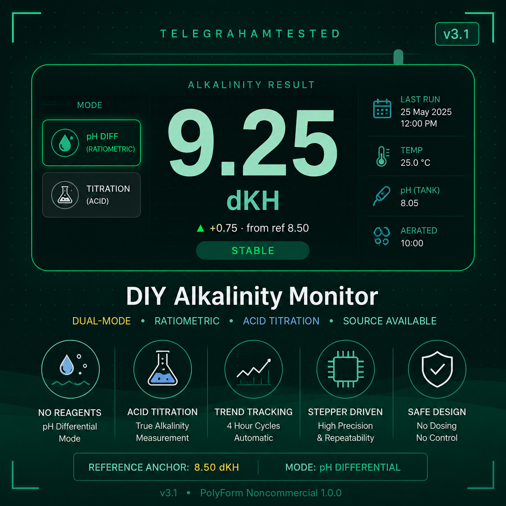

# Sentinel AlkTrack — DIY Ratiometric Alkalinity Monitor



**TelegrahamTested** — Firmware v3.1

Sentinel AlkTrack is an open, non-commercial DIY alkalinity monitor for reef aquariums. Version 3.0 supports two user-selectable operating modes:

1. **pH differential mode** — reagent-free trend monitoring using a known reference sample and a tank sample measured in the same reaction chamber.
2. **Acid titration mode** — true acid-demand alkalinity testing using a fixed tank-water sample volume and a known-strength acid reagent.

This project is intended for education, experimentation, and hobby use. It is not a commercial product, a laboratory instrument, or a replacement for independent judgment.

---

## What changed in v3.1

v3.1 is a safety and accuracy release. Upgrade from v3.0 is strongly recommended.

Safety:

- v3.0 did not compile (missing `#include` lines). Fixed.
- v3.0 left acidic sample in the chamber after any failed titration, and the next cycle filled on top of it. Cleanup now always runs, and every cycle starts by draining the chamber to waste.
- New chamber high-level switch (normally closed, fail-safe). Every fill stops the moment it trips.
- Software volume ledger refuses any fill that would exceed the chamber volume, set with `CAL CHAMBER`.
- Stepper drivers are disabled between moves (shared ENABLE pin).
- `PUMPS_OFF` is now a latched emergency stop. `RESUME` clears it. Settings cannot be changed while a cycle runs.

Titration accuracy:

- Tank-water rinse before every sample, so leftover endpoint water no longer dilutes the next test.
- Separate steps/mL calibration for every pump, with a guided `CALPUMP` routine.
- Titration continues to pH 3.0 and uses a true Gran fit on the post-equivalence region. The Gran result does not depend on a pH offset error. In v3.0 the Gran fit used the wrong pH region and never ran.
- The pH 4.5 endpoint is interpolated and reported as a cross-check. v3.0 always overshot by up to one dose (about +0.2 dKH at default settings).
- Titration is blocked until the pH probe has a 2- or 3-point calibration. New `PHCAL`, `PHCHECK` and `PHSLOPE` commands.

pH differential accuracy:

- Bracketed reference (REF, TANK, REF). If room CO2 or the probe moves during the cycle, the two references disagree and the result is rejected instead of reported.
- Temperature-dependent constants (K0, K1, K2, KB) at each sample's measured temperature.
- The reference reservoir is no longer contaminated with tank water.
- Equilibrium is checked by pH drift, and aeration is extended if needed.
- Will not run without a reference anchor.

v3.0 EEPROM settings are migrated automatically. Pumps A and C start with Pump B's calibration; run `CALPUMP A` and `CALPUMP C`.

---

## What changed in v3.0

Version 3.0 is no longer only a reagent-free pH differential trend monitor. It now includes a second operating mode for traditional acid titration.

Major changes:

- Stepper-driven peristaltic pumps replace relay-timed pump control.
- Volume is controlled by calibrated steps per mL instead of pump runtime.
- User-selectable modes are available from Serial Monitor:
  - `MODE PHDI` for pH differential/ratiometric mode.
  - `MODE TITR` for acid titration mode.
- Titration mode uses Pump D for acid reagent dosing.
- Titration mode calculates alkalinity from acid normality, endpoint volume, and sample volume.
- EEPROM calibration now stores operating mode, sample volume, acid normality, pump steps/mL, and dose increment.
- The titration dKH calculation uses the corrected conversion:

```text
dKH = (acid_normality × acid_mL / sample_mL) × 2800
```

---

## What it does

### pH differential mode

Draws a known reference sample into a shared reaction chamber, aerates it, records pH and temperature, then removes it. A tank sample is then drawn into the same chamber, aerated under the same general conditions, and measured with the same pH and temperature probes.

The reference is measured twice, before and after the tank sample. Room CO2 only cancels when both samples see the same CO2 level, so if the two reference readings disagree by more than 0.015 pH, the result is rejected.

The result is a **reference-anchored alkalinity trend estimate**. This mode is reagent-free and best used to watch whether alkalinity is rising, falling, or stable.

### Acid titration mode

Rinses the chamber with tank water, draws a fixed volume of tank water, then adds known-strength acid in measured increments using a stepper-driven dosing pump. Dosing continues past the endpoint to pH 3.0. The equivalence volume comes from a Gran fit on the pH 3.0–3.8 region, with the interpolated pH 4.5 endpoint reported as a cross-check. Alkalinity is calculated from the acid volume consumed.

This mode is a traditional chemical titration. It consumes reagent and produces acidic waste.

---

## Hardware summary

Minimum v3.0 hardware:

- ESP32 DevKit C, 38-pin
- Atlas Scientific EZO-pH circuit on an electrically isolated carrier
- Lab-grade double-junction pH probe with BNC connector
- DS18B20 waterproof temperature probe
- Four stepper-driven peristaltic pumps:
  - Pump A: reference reservoir to/from reaction chamber
  - Pump B: tank/sample fill
  - Pump C: chamber drain/waste or controlled evacuation
  - Pump D: acid reagent dosing for titration mode
- Four A4988 or DRV8825 stepper motor drivers
- Micro air pump and ceramic fine-bubble airstone
- Reference reservoir
- Acid reagent reservoir for titration mode
- Waste collection container (every cycle starts by draining the chamber to waste)
- Chamber high-level float switch, normally closed (GPIO 32 to GND)
- Stepper driver ENABLE pins tied together to GPIO 13, with a 10k pull-up to 3.3V
- 12V supply rated at 5A minimum
- 5V/USB supply for ESP32
- Optional trend output on GPIO 25: about 1.0 V (6 dKH) to 2.6 V (12 dKH). This is not a pH-electrode-level signal; feeding a controller pH input needs an isolated scaling stage

---

## Firmware

Open:

```text
alkalinity_monitor_v3_1/alkalinity_monitor_v3_1.ino
```

Libraries required when `SIMULATION_MODE false`:

- OneWire by Paul Stoffregen
- DallasTemperature by Miles Burton

First run:

1. Upload firmware with `SIMULATION_MODE true` for bench testing.
2. Open Serial Monitor at 115200 baud (line ending: Newline).
3. Confirm the firmware responds to `STATUS`.
4. Set `SIMULATION_MODE false`, re-upload.
5. Check `STATUS` shows `Level switch: OK`. Lift the float: it must show `HIGH/OPEN (fault)`.
6. Fill the chamber to the level switch with a syringe and enter that volume with `CAL CHAMBER <mL>` (default 40).
7. Prime tubing with `PRIME`.
8. Calibrate each pump: move its outlet into a graduated cylinder, send `CALPUMP B`, measure, then send `CALPUMP B <measured mL>`. Repeat for A, C and D.
9. Calibrate the pH probe: `PHCAL MID 7.00`, then `PHCAL LOW 4.00` (and optionally `PHCAL HIGH 10.00`). Verify with `PHCHECK 4.00`.
10. Set mode:
   - `MODE PHDI`, then the reference anchor, for example `CAL 8.50`.
   - `MODE TITR`, then `CAL ACID <N>` for your acid.
11. Send `RUN`.

---

## Serial commands

| Command | What it does |
|---|---|
| `STATUS` | Mode, state, last fault, level switch, all calibration values |
| `RUN` | Start a cycle now |
| `ABORT` | Stop the cycle; the chamber is still emptied |
| `PUMPS_OFF` | Emergency stop, latched |
| `RESUME` | Clear the emergency stop |
| `PRIME` | Prime all lines (pre-drains first) |
| `MODE PHDI` / `MODE TITR` | Select operating mode |
| `CAL 8.50` | pH differential reference anchor in dKH |
| `CAL ACID 0.1000` | Acid normality |
| `CAL SAMPLEML 25.0` | Sample volume in mL (limit depends on chamber volume) |
| `CAL DOSE 0.020` | Fine acid dose in mL |
| `CAL SAL 35.0` | Salinity in PSU (pH differential constants) |
| `CAL CHAMBER 40` | Chamber volume up to the level switch, in mL |
| `CALPUMP B` | Run a calibration volume on pump A, B, C or D |
| `CALPUMP B 9.85` | Enter the measured volume; updates steps/mL |
| `PHCAL MID 7.00` | EZO-pH calibration point (`MID` first, then `LOW`, `HIGH`; `PHCAL CLEAR`) |
| `PHCHECK 4.00` | Verify the probe in a buffer; reports pass/fail (±0.05) |
| `PHSLOPE` | Probe slope health (95–105% is good) |

Settings commands are refused while a cycle is running.

---

## How the two methods work

### pH differential/ratiometric mode


```text
TA_tank = (TA_ref - BA_ref) × carbonate_speciation_ratio + BA_tank
```

Where:

```text
carbonate_speciation_ratio =
[(K1_tank / H_tank) + (2 × K1_tank × K2_tank / H_tank²)] /
[(K1_ref / H_ref) + (2 × K1_ref × K2_ref / H_ref²)]
```

All internal alkalinity math must use compatible units. Inputs and outputs are shown in dKH.

### Acid titration mode

The equivalence volume `Ve` comes from a Gran fit after the endpoint, where `F = (V_sample + V_acid) × 10^-pH` is a straight line that crosses zero at `Ve`.

```text
dKH = (N_acid × V_acid_mL / V_sample_mL) × 2800
```

Where `N_acid` is acid normality, `V_acid_mL` is the endpoint acid volume, and `V_sample_mL` is the tank-water sample volume.

---

## Documents

| File | Description |
|---|---|
| `DIY_Alkalinity_Monitor_Build_Guide.docx` | Hardware, wiring, assembly, and calibration guide |
| `DIY_Alkalinity_Monitor_User_Guide.docx` | Operating instructions for both modes |
| `DIY_Alkalinity_Monitor_Price_Sheet_v3_1.xlsx` | Updated component price sheet |
| `DIY_Alkalinity_Monitor_Changelog.docx` | Version history through v3.1 |

Firmware and documents for v2.1 and v2.2 (pH differential only) are archived in [`Version 2/`](Version%202/).

---

## Roadmap

- Mode selection from a GUI instead of Serial Monitor
- Three-point pH probe calibration at 4.01, 7.01, and 10.01

---

## License

Free for personal, hobby and other noncommercial use under the [PolyForm Noncommercial License 1.0.0](LICENSE). Selling this software, devices built with it, or any part of it requires written permission from TelegrahamTested.

You may fork, modify and share it for personal, educational or hobby use. You may not sell the project files, kits, assembled devices or commercial products based on this design without written permission.

---

## Disclaimer

This project is provided as-is for educational, experimental, and hobby use. It includes water handling, electrical components, and optional acid reagent handling. Build and use it at your own risk. Verify all results with independent testing before making aquarium dosing decisions.
